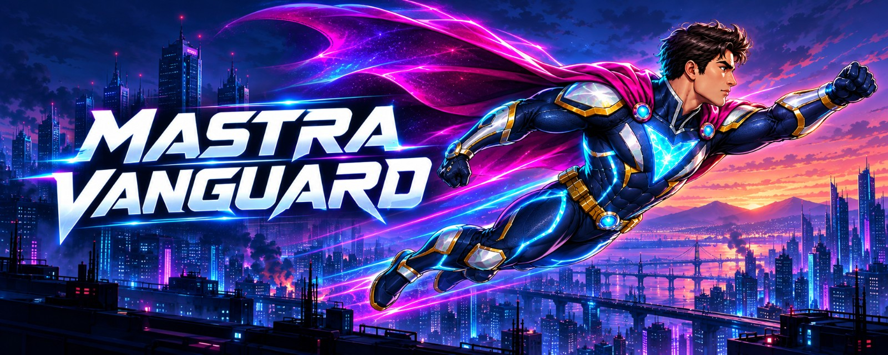
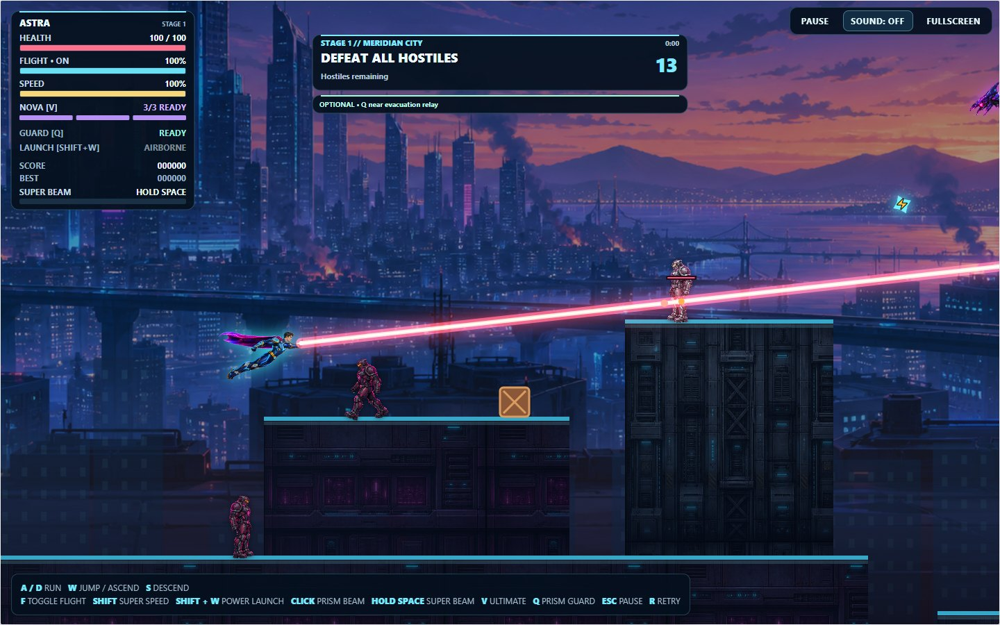
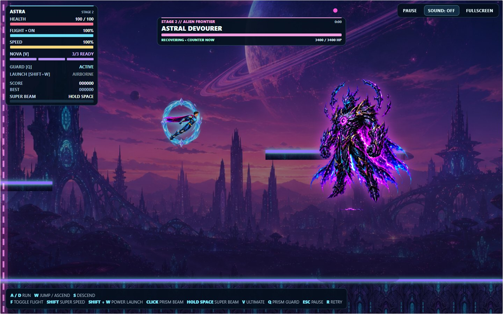
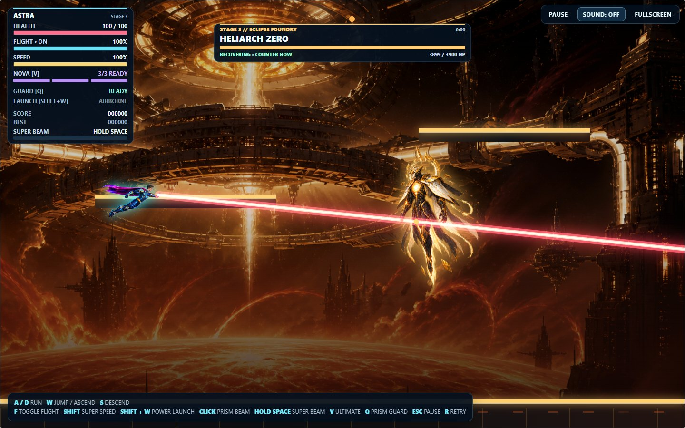
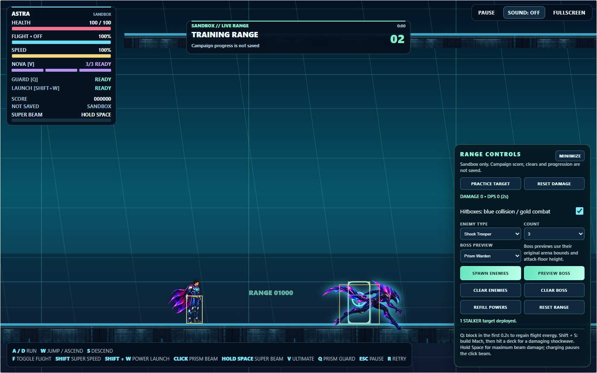

# Mastra Vanguard

**Three worlds. Three bosses. One prism-powered hero.**

Take flight as **Astra** in a 2D superhero action-platformer. Reach Mach speed, wield prism powers, and battle through the campaign—or practice in the Training Range.

   
  Desktop browser · Keyboard + mouse · No installation

  
  &nbsp; · &nbsp; <a href="CHANGELOG.md">Release history</a>
  &nbsp; · &nbsp; <a href="docs/PLAYING.md">Player guide</a>

- **Move with power:** free flight, Power Launch, Super Speed, and Mach landing shockwaves.
- **Fight with precision:** continuous Prism Beam, charged Super Beam, Prism Nova, and timed Prism Guard.
- **Play your way:** stage best scores, optional bonuses, God Mode, and adjustable audio and visual effects.

## The campaign

### Stage 1 · Meridian City

Defend neon rooftops against troopers and drones, then confront the **Prism Warden**.

<table>
  <tr>
    <td width="50%" valign="top">
      <h3>Stage 2 · Alien Frontier</h3>
      
Cross crystal terraces, fight alien hostiles, and challenge the <strong>Astral Devourer</strong>.

      
    </td>
    <td width="50%" valign="top">
      <h3>Stage 3 · Eclipse Foundry</h3>
      
Battle through an orbital solar forge and shut down <strong>Heliarch Zero</strong>.

      
    </td>
  </tr>
</table>

Generated cover art; actual game-renderer screenshots with staged camera and actor positions. Click any screenshot to enlarge.

<strong>Training Range · Combat sandbox</strong>

Spawn all seven enemy types or preview any boss in a large flight sandbox. Practice with damage/DPS readouts, hitbox overlays, and power refills. Campaign progress is unaffected.

## Quick start

Choose **Stage 1**, clear the hostiles, and follow the arena marker to the boss. Toggle **God Mode** in the main or pause menu for invincibility, unlimited energy, and unlimited Nova charges.

<strong>Controls</strong>

| Input | Action |
| --- | --- |
| `A` / `D` | Move |
| `W` / `S` | Jump or ascend / descend in flight |
| `F` | Toggle flight |
| Hold `Shift` | Super Speed |
| Hold `Shift` + `W` on the ground | Power Launch |
| Aim + hold left mouse button | Prism Beam |
| Hold, then release `Space` | Super Beam |
| `V` | Prism Nova |
| `Q` | Prism Guard |
| `Esc` | Pause / resume |
| `R` after defeat or completion | Retry |

[Power tips, stage bonuses, and settings](docs/PLAYING.md).

**Play offline:** download the repository and open `index.html` with its assets alongside it. No installation, build step, or server is required.

**Settings:** music/SFX volume, screen shake, effects quality, reduced motion, and reduced flashing. Preferences are saved locally.

---

A long-term creative project by [Joji228](https://github.com/Joji228), developed with **Codex**, beginning with **GPT-5.6**.

**Current version: 0.12** · Boss combat & effects · [Report a bug](https://github.com/Joji228/Mastra-Vanguard/issues) · [Development & tests](docs/DEVELOPMENT.md) · [Presentation assets](docs/PRESENTATION.md)
